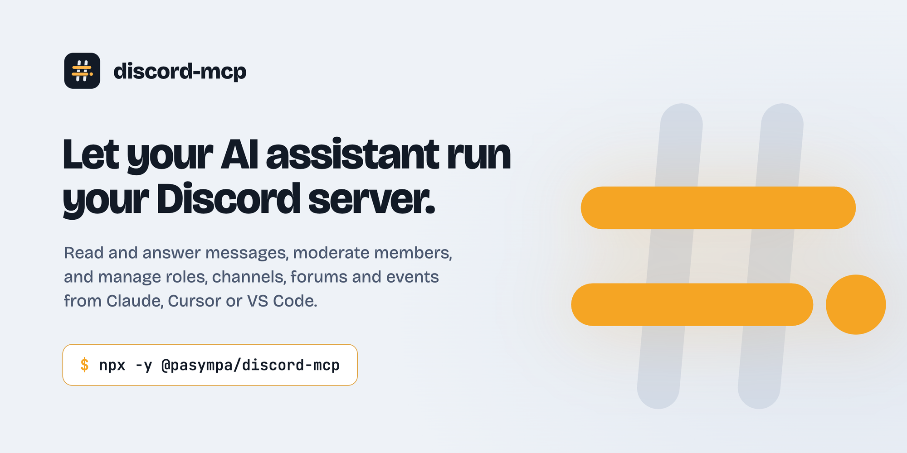
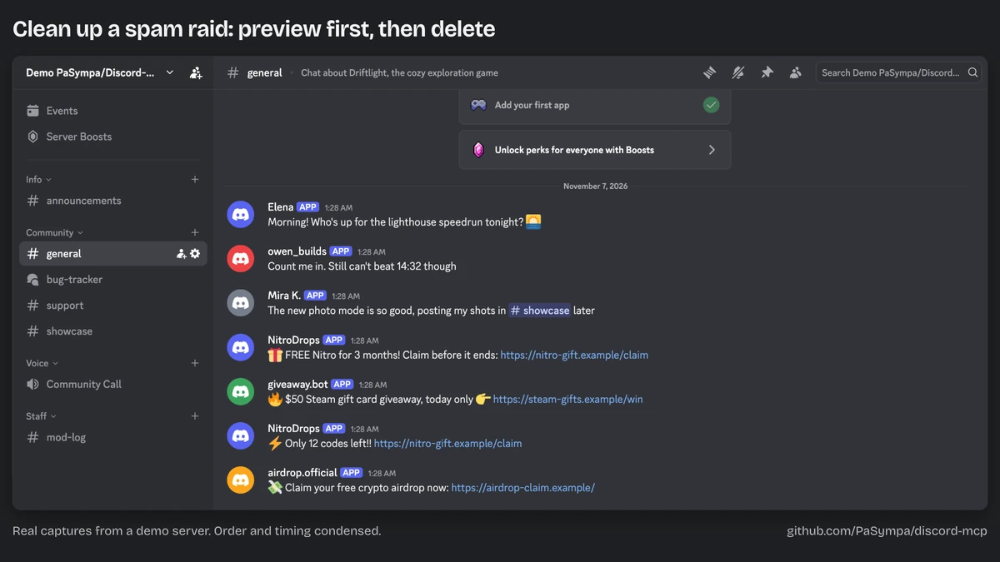

<div align="center">

<picture>
  <source media="(prefers-color-scheme: dark)" srcset=".github/assets/banner-dark.png">
  
</picture>

[](https://www.npmjs.com/package/@pasympa/discord-mcp)
[](https://www.npmjs.com/package/@pasympa/discord-mcp)
[](LICENSE)
[](https://glama.ai/mcp/servers/PaSympa/discord-mcp)

[](https://vscode.dev/redirect/mcp/install?name=discord&inputs=%5B%7B%22type%22%3A%22promptString%22%2C%22id%22%3A%22discord_token%22%2C%22description%22%3A%22Discord%20bot%20token%22%2C%22password%22%3Atrue%7D%5D&config=%7B%22command%22%3A%22npx%22%2C%22args%22%3A%5B%22-y%22%2C%22%40pasympa%2Fdiscord-mcp%22%5D%2C%22env%22%3A%7B%22DISCORD_TOKEN%22%3A%22%24%7Binput%3Adiscord_token%7D%22%7D%7D)
[](https://insiders.vscode.dev/redirect/mcp/install?name=discord&inputs=%5B%7B%22type%22%3A%22promptString%22%2C%22id%22%3A%22discord_token%22%2C%22description%22%3A%22Discord%20bot%20token%22%2C%22password%22%3Atrue%7D%5D&config=%7B%22command%22%3A%22npx%22%2C%22args%22%3A%5B%22-y%22%2C%22%40pasympa%2Fdiscord-mcp%22%5D%2C%22env%22%3A%7B%22DISCORD_TOKEN%22%3A%22%24%7Binput%3Adiscord_token%7D%22%7D%7D&quality=insiders)
[](https://cursor.com/en/install-mcp?name=discord&config=eyJjb21tYW5kIjoibnB4IiwiYXJncyI6WyIteSIsIkBwYXN5bXBhL2Rpc2NvcmQtbWNwIl0sImVudiI6eyJESVNDT1JEX1RPS0VOIjoiWU9VUl9CT1RfVE9LRU4ifX0%3D)

</div>

**discord-mcp** connects Claude, Codex, Cursor, VS Code and any other MCP client to your Discord server through your own bot. Ask in plain language: your assistant reads channels, answers, moderates, and manages roles, channels, forums and events, with 100 tools behind it.

## See it in action

<p align="center">
  <a href="https://github.com/user-attachments/assets/c87d8fe5-6c9c-4186-ab95-c154f4987502"></a>
</p>

<p align="center"><a href="https://github.com/user-attachments/assets/c87d8fe5-6c9c-4186-ab95-c154f4987502">Watch the full one-minute demo</a>: a channel recap, a bug forum, the spam cleanup and an event.</p>

<sub>Calls made live with Claude Code on a demo server; the panel summarizes their results. The Discord window shows real captures, except that the spot of each new message or post stays blank until it appears.</sub>

## What you can ask

| You want to                  | Ask your assistant                                                                 |
| ---------------------------- | ---------------------------------------------------------------------------------- |
| Catch up on a busy channel   | "Summarize what's going on in #support and post a recap in #mod-log."              |
| Turn feedback into a tracker | "Open a bug-tracker forum and file the two open bugs from the recap."              |
| Stop a spam raid safely      | "A spam raid just hit #general. Preview the cleanup, then remove it."              |
| Run community events         | "Schedule a community call next Friday at 8 PM and announce it in #announcements." |
| Audit permissions            | "Show me every permission overwrite in the server."                                |
| Welcome people               | "Create an invite to #welcome that expires in 24 hours."                           |
| Automate notifications       | "Create a webhook on #deploys and post the release notes as an embed."             |

## Quick start

1. **Create a bot.** In the [Discord Developer Portal](https://discord.com/developers/applications), create an application, open **Bot**, then **Reset Token** and copy it. On the same page, enable **Server Members Intent** and **Message Content Intent**.
2. **Invite it to your server.** Replace `YOUR_CLIENT_ID` with the Application ID from **General Information**, then open the link:

   ```
   https://discord.com/oauth2/authorize?client_id=YOUR_CLIENT_ID&scope=bot&permissions=2270827458424055
   ```

   It requests the permissions the tools use. Remove the ones you do not need in the authorization screen.

3. **Add it to your client.** Use a button above, or paste this into your client's MCP config:

   ```json
   {
     "mcpServers": {
       "discord": {
         "command": "npx",
         "args": ["-y", "@pasympa/discord-mcp"],
         "env": {
           "DISCORD_TOKEN": "YOUR_BOT_TOKEN"
         }
       }
     }
   }
   ```

`npx` downloads and runs the server (Node.js 22 or later); nothing else to install. Per-client instructions are under [Clients](#clients).

## Expose only what you need

The full set of 100 tools costs about 32k tokens of context when a client loads them all. Most assistants need a fraction of it: set `DISCORD_MCP_TOOLSETS` to the toolsets you want.

| Profile              | `DISCORD_MCP_TOOLSETS`                           | Tools | Context     |
| -------------------- | ------------------------------------------------ | ----- | ----------- |
| Everything (default) | unset                                            | 100   | ~32k tokens |
| Chat assistant       | `discovery,messages`                             | 25    | ~9k tokens  |
| Community manager    | `discovery,messages,forums,scheduled_events`     | 42    | ~15k tokens |
| Moderator            | `discovery,members,moderation,roles,permissions` | 31    | ~9k tokens  |
| Audit and stats      | `discovery,stats,moderation`                     | 6     | ~2k tokens  |

```json
"env": {
  "DISCORD_TOKEN": "YOUR_BOT_TOKEN",
  "DISCORD_MCP_TOOLSETS": "discovery,messages"
}
```

Context sizes are measured on the `tools/list` response (bytes divided by 4). Toolsets: `discovery`, `messages`, `channels`, `permissions`, `members` (includes kick, ban and timeout), `roles`, `moderation` (the audit log), `screening`, `stats`, `forums`, `webhooks`, `scheduled_events`, `invites`, `dm`. A toolset brings its whole module, destructive tools included; an unknown name stops the server at startup instead of exposing everything.

Set `DISCORD_MCP_READ_ONLY=true` to keep only the 35 tools annotated `readOnlyHint: true`, about 13k tokens. It narrows `DISCORD_MCP_TOOLSETS` instead of replacing it: `discovery,messages` then exposes 11 tools, about 5k tokens. A selection with no read-only tool left, such as `channels` alone, stops the server at startup.

## Safety

- **Your bot, your permissions.** The server can only do what the bot's Discord permissions allow.
- **Preview before mass actions.** `discord_bulk_delete_messages`, `discord_bulk_ban`, `discord_prune_members` and `discord_delete_channel` run as a dry run by default and report what would happen. Pass `dry_run: false` to apply.
- **Stay in your servers.** `DISCORD_ALLOWED_GUILDS` restricts every call to the guilds you list, whether the target is addressed by guild, channel, thread, webhook or invite.
- **Clear annotations.** Every tool declares `readOnlyHint`, and every write tool declares `destructiveHint`, so clients can approve reads automatically and ask before destructive calls.
- **Read-only mode.** With `DISCORD_MCP_READ_ONLY=true`, the server lists only the tools that declare `readOnlyHint: true`. A call to any other tool fails as an unknown tool. Two reads stay sensitive. `discord_list_webhooks` returns webhook tokens, and a token lets anyone post through its webhook without this server. `discord_read_dms` reads the bot's direct messages with a user. To hide both, leave `webhooks` and `dm` out of `DISCORD_MCP_TOOLSETS`.
- **Keep the token out of files.** Prefer your client's secret prompt (the VS Code button asks for the token) over a config file you might commit.

## Clients

<details>
<summary><strong>Claude Desktop</strong></summary>

**Bundle.** Download `discord-mcp.mcpb` from the [latest release](https://github.com/PaSympa/discord-mcp/releases/latest) and open it. Claude Desktop shows an install screen: enter the bot token there. The other settings are optional and match [Configuration](#configuration). The bundle runs on the Node.js built into Claude Desktop, so there is nothing else to install.

- On Windows, the file may not open in Claude Desktop. Install it from **Settings > Extensions > Advanced settings > Install Extension** instead.
- After you change a setting, quit and reopen Claude Desktop.
- The bundle does not update itself. After each release, download and open the new `discord-mcp.mcpb`.

**Config file.** Or add the config from [Quick start](#quick-start) to `claude_desktop_config.json`, then restart Claude Desktop.

- **macOS**: `~/Library/Application Support/Claude/claude_desktop_config.json`
- **Windows**: `%APPDATA%\Claude\claude_desktop_config.json`

</details>

<details>
<summary><strong>Claude Code</strong></summary>

```bash
claude mcp add discord -e DISCORD_TOKEN=YOUR_BOT_TOKEN -- npx -y @pasympa/discord-mcp
```

</details>

<details>
<summary><strong>Cursor</strong></summary>

Use the **Install in Cursor** button, then replace `YOUR_BOT_TOKEN`. Or add the config from [Quick start](#quick-start) to `~/.cursor/mcp.json`. See the [Cursor MCP docs](https://docs.cursor.com/context/model-context-protocol).

</details>

<details>
<summary><strong>VS Code / GitHub Copilot</strong></summary>

Use the **Install in VS Code** button: VS Code asks for the token and stores it as a secret. Or add this to `.vscode/mcp.json`:

```json
{
  "inputs": [
    {
      "type": "promptString",
      "id": "discord_token",
      "description": "Discord bot token",
      "password": true
    }
  ],
  "servers": {
    "discord": {
      "command": "npx",
      "args": ["-y", "@pasympa/discord-mcp"],
      "env": {
        "DISCORD_TOKEN": "${input:discord_token}"
      }
    }
  }
}
```

See the [VS Code MCP docs](https://code.visualstudio.com/docs/copilot/chat/mcp-servers).

</details>

<details>
<summary><strong>Windsurf</strong></summary>

Add the config from [Quick start](#quick-start) to `~/.codeium/windsurf/mcp_config.json`, then refresh the MCP servers list.

</details>

<details>
<summary><strong>Codex CLI</strong></summary>

```bash
codex mcp add discord --env DISCORD_TOKEN=YOUR_BOT_TOKEN -- npx -y @pasympa/discord-mcp
```

</details>

<details>
<summary><strong>Cline</strong></summary>

Open **MCP Servers**, then **Configure**, and add the config from [Quick start](#quick-start) to `cline_mcp_settings.json`.

</details>

<details>
<summary><strong>Docker</strong></summary>

```json
{
  "mcpServers": {
    "discord": {
      "command": "docker",
      "args": ["run", "--rm", "-i", "-e", "DISCORD_TOKEN", "pasympa/discord-mcp:latest"],
      "env": {
        "DISCORD_TOKEN": "YOUR_BOT_TOKEN"
      }
    }
  }
}
```

</details>

<details>
<summary><strong>From source</strong></summary>

```bash
git clone https://github.com/PaSympa/discord-mcp
cd discord-mcp
npm install && npm run build
```

```json
{
  "mcpServers": {
    "discord": {
      "command": "node",
      "args": ["/absolute/path/to/discord-mcp/dist/index.js"],
      "env": {
        "DISCORD_TOKEN": "YOUR_BOT_TOKEN"
      }
    }
  }
}
```

You can also put `DISCORD_TOKEN=YOUR_BOT_TOKEN` in a `.env` file at the project root; the server loads it on start.

</details>

## Configuration

| Variable                  | Default | Description                                                                                                                                                                    |
| ------------------------- | ------- | ------------------------------------------------------------------------------------------------------------------------------------------------------------------------------ |
| `DISCORD_TOKEN`           | none    | **Required.** Bot token.                                                                                                                                                       |
| `DISCORD_MCP_TOOLSETS`    | `all`   | Comma-separated toolsets to expose (see [Expose only what you need](#expose-only-what-you-need)). Unset, empty or `all` exposes every tool.                                    |
| `DISCORD_MCP_READ_ONLY`   | `false` | Set to `true` to expose only the tools annotated `readOnlyHint: true`. Accepts true/false, 1/0, yes/no or on/off; any other value stops the server at startup.                 |
| `DISCORD_ALLOWED_GUILDS`  | all     | Comma-separated guild IDs the server may act on. Calls that target any other guild are rejected, whether addressed by guild ID, channel ID, thread ID, webhook or invite code. |
| `DISCORD_MESSAGE_CONTENT` | `true`  | Set to `false` to stop requesting the Message Content privileged intent at connect time.                                                                                       |
| `DISCORD_GUILD_MEMBERS`   | `true`  | Set to `false` to stop requesting the Server Members privileged intent at connect time.                                                                                        |

The intent flags only change what the bot requests when it connects. Requesting a privileged intent that is not enabled in the Developer Portal closes the connection with code `4014`; set the flag to `false` to connect anyway. What the tools can read is governed by the portal toggles: every message is fetched over the REST API, which Discord gates on the portal setting alone. With Message Content off in the portal, message bodies come back empty (`content`, `embeds`, `attachments`), except the bot's own messages, DMs and messages that mention the bot; with Server Members off, member listing fails.

## Tools

100 tools in 14 toolsets. Each one documents its permissions, side effects and return shape in its description.

<details>
<summary><strong>Discovery</strong> (4 tools)</summary>

| Tool                           | Description                                                      |
| ------------------------------ | ---------------------------------------------------------------- |
| `discord_list_guilds`          | List all servers the bot is connected to                         |
| `discord_get_guild_info`       | Get detailed guild info (name, members, channels, roles, boosts) |
| `discord_list_channels`        | List all channels in a guild grouped by category                 |
| `discord_find_channel_by_name` | Find a channel by name (partial match)                           |

</details>

<details>
<summary><strong>Messages</strong> (21 tools)</summary>

| Tool                              | Description                                              |
| --------------------------------- | -------------------------------------------------------- |
| `discord_read_messages`           | Read messages, paging back through history               |
| `discord_send_message`            | Send a plain text message                                |
| `discord_reply_message`           | Reply to a specific message                              |
| `discord_edit_message`            | Edit a message sent by the bot                           |
| `discord_delete_message`          | Delete a specific message                                |
| `discord_add_reaction`            | Add a reaction emoji to a message                        |
| `discord_remove_reactions`        | Remove reactions (all, by emoji, or by user)             |
| `discord_get_reactions`           | List users who reacted with a specific emoji             |
| `discord_create_thread`           | Create a thread from a message or standalone             |
| `discord_list_channel_threads`    | List a text channel's threads, paged                     |
| `discord_bulk_delete_messages`    | Delete multiple messages at once (2-100)                 |
| `discord_send_embed`              | Send a rich embed with all options                       |
| `discord_edit_embed`              | Edit an embed previously sent by the bot                 |
| `discord_send_multiple_embeds`    | Send up to 10 embeds in a single message                 |
| `discord_pin_message`             | Pin or unpin a message                                   |
| `discord_get_message_attachments` | List a message's attachments with download urls          |
| `discord_fetch_pinned_messages`   | List a channel's pinned messages, paged                  |
| `discord_search_messages`         | Search messages by keyword (last 100)                    |
| `discord_search_guild_messages`   | Search across every channel using Discord's search index |
| `discord_crosspost_message`       | Publish a message to announcement channel followers      |
| `discord_forward_message`         | Forward a message to another channel                     |

</details>

<details>
<summary><strong>Channels</strong> (8 tools)</summary>

| Tool                                  | Description                              |
| ------------------------------------- | ---------------------------------------- |
| `discord_create_channel`              | Create a text, voice channel or category |
| `discord_delete_channel`              | Delete a channel                         |
| `discord_edit_channel`                | Edit name, topic, slowmode, NSFW flag    |
| `discord_move_channel`                | Move a channel into/out of a category    |
| `discord_clone_channel`               | Clone a channel with its permissions     |
| `discord_set_channel_position`        | Set display position within a category   |
| `discord_follow_announcement_channel` | Follow an announcement channel           |
| `discord_lock_channel_permissions`    | Sync permissions with parent category    |

</details>

<details>
<summary><strong>Channel permissions</strong> (6 tools)</summary>

| Tool                                | Description                                      |
| ----------------------------------- | ------------------------------------------------ |
| `discord_get_channel_permissions`   | List all permission overwrites on a channel      |
| `discord_set_role_permission`       | Allow/deny permissions for a role on a channel   |
| `discord_set_member_permission`     | Allow/deny permissions for a member on a channel |
| `discord_reset_channel_permissions` | Remove all overwrites (reset to inherited)       |
| `discord_copy_permissions`          | Copy overwrites from one channel to another      |
| `discord_audit_permissions`         | Full permission audit for all channels           |

</details>

<details>
<summary><strong>Members</strong> (11 tools)</summary>

| Tool                      | Description                                          |
| ------------------------- | ---------------------------------------------------- |
| `discord_list_members`    | List guild members with their roles                  |
| `discord_get_member_info` | Detailed member info (roles, permissions, join date) |
| `discord_search_members`  | Search members by username or nickname               |
| `discord_set_nickname`    | Set or clear a member's nickname                     |
| `discord_kick_member`     | Kick a member                                        |
| `discord_ban_member`      | Ban a member (optionally delete recent messages)     |
| `discord_unban_member`    | Unban a user                                         |
| `discord_bulk_ban`        | Ban multiple users at once (raid mitigation)         |
| `discord_list_bans`       | List all banned users                                |
| `discord_timeout_member`  | Timeout a member (0 to remove)                       |
| `discord_prune_members`   | Remove inactive members (with dry run)               |

</details>

<details>
<summary><strong>Roles</strong> (9 tools)</summary>

| Tool                        | Description                                                |
| --------------------------- | ---------------------------------------------------------- |
| `discord_list_roles`        | List all roles with permissions and member count           |
| `discord_create_role`       | Create a new role                                          |
| `discord_edit_role`         | Edit a role (name, color, permissions, hoist, mentionable) |
| `discord_delete_role`       | Delete a role                                              |
| `discord_add_role`          | Assign a role to a member                                  |
| `discord_remove_role`       | Remove a role from a member                                |
| `discord_get_role_members`  | List all members with a specific role                      |
| `discord_set_role_position` | Change a role's position in the hierarchy                  |
| `discord_set_role_icon`     | Set a custom icon or unicode emoji on a role               |

</details>

<details>
<summary><strong>Forums</strong> (10 tools)</summary>

| Tool                           | Description                          |
| ------------------------------ | ------------------------------------ |
| `discord_get_forum_channels`   | List all forum channels in a guild   |
| `discord_create_forum_channel` | Create a new forum channel           |
| `discord_create_forum_post`    | Create a post/thread in a forum      |
| `discord_get_forum_post`       | Get a post's details and messages    |
| `discord_list_forum_threads`   | List threads (active + archived)     |
| `discord_reply_to_forum`       | Reply to a forum post                |
| `discord_delete_forum_post`    | Delete a forum thread                |
| `discord_get_forum_tags`       | Get available tags                   |
| `discord_set_forum_tags`       | Set/update tags on a forum           |
| `discord_update_forum_post`    | Update title, archived, locked, tags |

</details>

<details>
<summary><strong>Webhooks</strong> (8 tools)</summary>

| Tool                             | Description                                       |
| -------------------------------- | ------------------------------------------------- |
| `discord_create_webhook`         | Create a webhook on a channel                     |
| `discord_send_webhook_message`   | Send via webhook (custom username/avatar, embeds) |
| `discord_edit_webhook`           | Edit a webhook's name, avatar, or channel         |
| `discord_delete_webhook`         | Delete a webhook                                  |
| `discord_list_webhooks`          | List webhooks for a channel or guild              |
| `discord_edit_webhook_message`   | Edit a message sent by a webhook                  |
| `discord_delete_webhook_message` | Delete a message sent by a webhook                |
| `discord_fetch_webhook_message`  | Fetch a specific webhook message                  |

</details>

<details>
<summary><strong>Scheduled events</strong> (7 tools)</summary>

| Tool                             | Description                               |
| -------------------------------- | ----------------------------------------- |
| `discord_list_scheduled_events`  | List all scheduled events in a guild      |
| `discord_get_scheduled_event`    | Get detailed info about a scheduled event |
| `discord_create_scheduled_event` | Create a voice, stage, or external event  |
| `discord_edit_scheduled_event`   | Edit an existing scheduled event          |
| `discord_delete_scheduled_event` | Delete a scheduled event                  |
| `discord_get_event_subscribers`  | Get users who marked "Interested"         |
| `discord_create_event_invite`    | Create an invite linked to an event       |

</details>

<details>
<summary><strong>Direct messages</strong> (7 tools)</summary>

| Tool                    | Description                                      |
| ----------------------- | ------------------------------------------------ |
| `discord_send_dm`       | Send a direct message to a user by their user ID |
| `discord_send_dm_embed` | Send an embed in a DM to a user                  |
| `discord_read_dms`      | Read message history from a DM conversation      |
| `discord_reply_dm`      | Reply to a specific DM message                   |
| `discord_edit_dm`       | Edit a previously sent DM (text)                 |
| `discord_edit_dm_embed` | Edit a previously sent DM embed                  |
| `discord_delete_dm`     | Delete a DM message                              |

</details>

<details>
<summary><strong>Invites</strong> (5 tools)</summary>

| Tool                           | Description                             |
| ------------------------------ | --------------------------------------- |
| `discord_list_invites`         | List all active invites in a guild      |
| `discord_list_channel_invites` | List invites for a specific channel     |
| `discord_get_invite`           | Get details about an invite by its code |
| `discord_create_invite`        | Create an invite link for a channel     |
| `discord_delete_invite`        | Revoke an invite                        |

</details>

<details>
<summary><strong>Moderation, screening and stats</strong> (4 tools)</summary>

| Tool                                  | Description                                         |
| ------------------------------------- | --------------------------------------------------- |
| `discord_get_audit_log`               | Fetch the guild audit log                           |
| `discord_get_membership_screening`    | Get the membership screening form                   |
| `discord_update_membership_screening` | Update screening rules for new members              |
| `discord_get_server_stats`            | Server stats: members, channels, roles, boost level |

</details>

## Troubleshooting

- **Every call fails with close code `4014`.** The bot requests a privileged intent that is off in the Developer Portal. Enable Server Members and Message Content there, or set `DISCORD_GUILD_MEMBERS=false` / `DISCORD_MESSAGE_CONTENT=false`.
- **Messages come back with empty text.** Message Content is off in the portal. Enable it; the flag alone does not change what the REST API returns.
- **A channel reads as empty.** The bot lacks Read Message History there: Discord returns an empty list rather than an error.
- **`Missing Access` or `Missing Permissions`.** The bot cannot see the channel, or the target role or member sits above the bot's highest role. Check overwrites with `discord_get_channel_permissions`.
- **Finding IDs.** Enable **Developer Mode** in Discord (Settings, Advanced), then right-click a server, channel or user and choose **Copy ID**.

## Contributing

Contributions are welcome. [CONTRIBUTING.md](CONTRIBUTING.md) covers the module layout, the tool definition quality bar and the release flow. Report vulnerabilities as described in [SECURITY.md](SECURITY.md).

## License

MIT, see [LICENSE](LICENSE). discord-mcp is an independent open-source project, not affiliated with or endorsed by Discord Inc.

VS Code and VS Code Insiders icons: [Codicons](https://github.com/microsoft/vscode-codicons) © Microsoft Corporation, licensed under [CC BY 4.0](https://creativecommons.org/licenses/by/4.0/).
